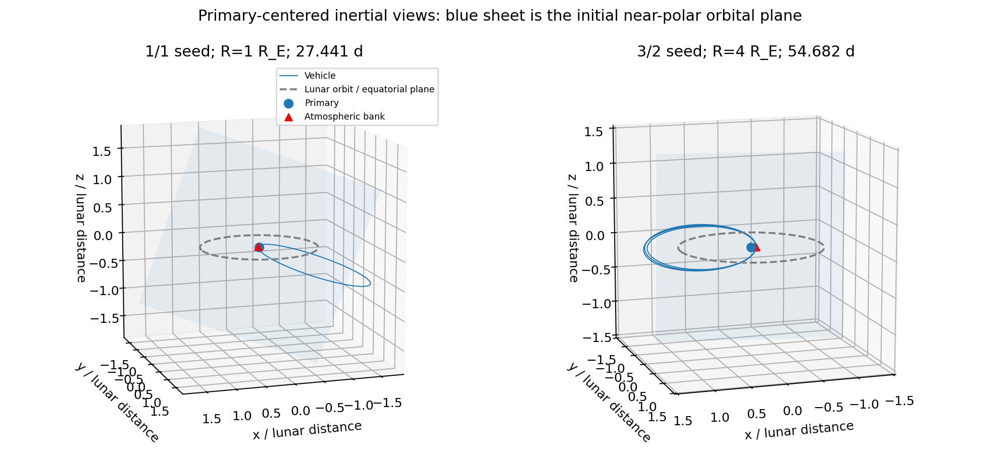
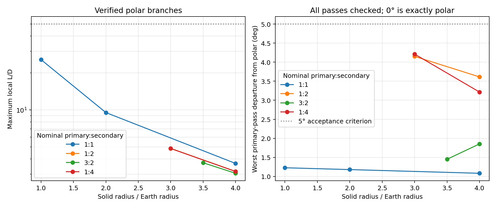
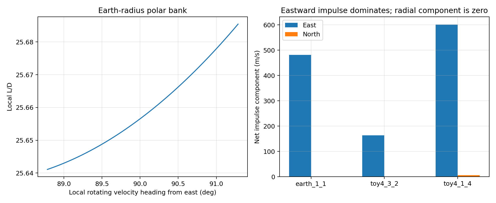

# Polar aerocycler: verified closures and resonance/radius comparison

2026-10-17. All calculations use the repository's `.env` Python environment.

For a focused description of **just the 27.4413-day Earth-radius orbit**, see
the [orbit dossier](aerocycler_27day/README.md), its
[technical verification record](aerocycler_27day/TECHNICAL.md), and the
[offline interactive 3D page](aerocycler_27day/index.html).

## The intended polar encounter now closes

This investigation finds **nine independently verified polar return
checkpoints** in the intended instantaneous-impulse, circular restricted
three-body model. Every primary encounter in these checkpoints is within
**5° of polar**. The atmospheric impulse is predominantly **eastward**, with
zero radial component. Lift/drag feasibility is checked throughout the
velocity-space turn, with strictly positive drag.

One particularly clean toy example is:

| Quantity | Verified value |
|---|---:|
| Nominal resonance, primary orbits : lunar periods | **3:2** |
| Primary solid radius | **3.5 Earth radii = 22,323.477 km** |
| Period of closed lunar-relative return | **54.68918736 days** |
| Primary close passes per cycle | **3** |
| Atmospheric impulses per cycle | **1**, at the final pass |
| Largest departure from polar at any primary pass | **1.45117°** |
| Osculating inclination over the entire coast | **87.906°–92.588°** |
| Maximum local L/D | **3.71947** |
| Impulse: east / north / radial | **+115.354 / +0.187 / 0 m/s** |
| Atmospheric interface altitude | **100 km** |
| Largest primary-center distance during coast | **571,801 km** |
| Closest lunar altitude | **167,381 km** |

There is also an **Earth-radius** checkpoint in the same aligned-spin model:
**27.44133564 days**, **L/D ≤ 25.68544**, incoming inclination **91.13432°**,
outgoing inclination **88.77192°**, and impulse **+481.452 m/s eastward**,
**+0.294 m/s northward**, **zero radially**. Its worst primary-pass departure
from polar is only **1.22808°**.

These establish basic polar, rotation-powered closure. The intended
application is **repeated atmospheric propellant collection**, not transport
between Earth and the Moon. A close lunar flyby is not a requirement: the
Moon can provide the necessary coast perturbations from a distance. For
geometric context, the Earth-radius example never comes closer than about
**376,142 km above the Moon**, and the closest retained toy example remains
about **163,012 km above it**. Collection mass loading and net resource yield
have not yet been modeled.

The previous **26.724-day, L/D 37.46** orbit was a separate, mostly eastward
encounter geometry. It remains in the [earlier review](aerocycler_revisit.md)
for provenance; it is **not the polar result** reported here.

## What is constrained, and what the angles mean

The primary spin axis and the secondary's orbital normal are both `+z` in
this toy model. At every primary periapsis, both before and after any bank,
the primary-relative inertial angular momentum is calculated:

```text
h = q cross v_inertial
i = acos(h_z / |h|)
departure_from_polar = |i - 90 degrees|.
```

An inclination of **90° is polar**, and **0° is equatorial/prograde**. This
diagnostic does not depend on the choice of inertial versus lunar rotating
axes, since rotating around `z` cannot change `h_z / |h|`.

The optimizer's initial heading is bounded to stay within 5° of local north.
The resulting **incoming inclinations at every primary pass are checked
independently**, rather than assuming a polar departure guarantees a polar
return. A closed but nearly equatorial orbit is explicitly rejected by the
polar validator. Five degrees is an explicit investigation acceptance
criterion, **not a derived universal limit**.

These quantities must remain separate:

- **Inclination** describes the instantaneous orbital plane relative to the
  equatorial plane. This is the polar criterion above.
- **Periapsis latitude** describes where on the primary the pass occurs.
  A polar orbit can have periapsis at latitude 0°, 19°, or elsewhere. It does
  not have to pass near a geographical pole at periapsis.
- **Local heading** describes the velocity direction above local east.
  Heading 90° is northward; a small heading offset selects a member of the
  return family. It is not the same angle as inclination at nonzero latitude.
- **Position latitude during the coast** describes the Earth-center-to-vehicle
  line. A highly eccentric polar ellipse can have a nearly equatorial major
  axis and a thin north/south extent. Its appearance does not make its
  encounter equatorial: the orbital normal and pass velocity decide that.

The Earth-radius checkpoint has inclination **81.527°–91.158°** during the
coast, even though its primary-pass inclinations stay within 1.23° of polar.
For a stricter whole-flight polar example, the 3:2 toy checkpoint above stays
within **2.59° of polar for the entire sampled coast**.



The blue sheets show initial orbital planes. These are primary-centered
**inertial** views; the dashed circle lies in the lunar/equatorial plane.
Lunar gravity changes the instantaneous plane during the coast. No claim of
one fixed Kepler ellipse throughout the cycle is made.

## Resonance comparison

**Convention:** `N:M` means `N` primary orbits during approximately `M` lunar
sidereal periods. The count is a nominal Kepler resonance used to select the
branch. The propagated return is fully closed in the **lunar rotating frame**.

The actual periods differ slightly from integer lunar periods because the
inertial apsidal/orbital orientation precesses. For example, the Earth-radius
1:1 case takes **1.00438021 lunar periods**, with an inertial return-position
rotation of **1.57688° beyond one revolution**. Its spacecraft/Moon relative
configuration and aligned rotating atmosphere repeat exactly in the model.
It is accurate to call this a **precessing near-1:1 return**, rather than
claiming an exact integer sidereal-period ratio.

Separate searches enforcing **exactly** `M` lunar periods did not converge
to accepted near-polar roots in the sampled starts. Those failures remain
in the logs; the near-resonant roots are not silently relabeled exact.

All rows below passed independent fixed-input propagation at two tolerances.
"Passes/banks" counts primary periapses and atmospheric impulses per cycle.
The listed polar departure is the maximum over all primary-pass endpoints.

| Nominal N:M | Radius / Earth radius | Actual period, days | Passes / banks | Worst departure from polar | Max local L/D | Closest lunar altitude, km |
|---|---:|---:|---:|---:|---:|---:|
| 1:1 | 1.0 | 27.441336 | 1 / 1 | 1.228° | 25.685 | 376,142 |
| 1:1 | 2.0 | 27.441770 | 1 / 1 | 1.180° | 9.528 | 369,651 |
| 1:1 | 4.0 | 27.441404 | 1 / 1 | 1.083° | 3.673 | 356,907 |
| 1:2 | 3.0 | 54.526476 | 1 / 1 | 4.151° | 4.870 | 212,111 |
| 1:2 | 4.0 | 54.540559 | 1 / 1 | 3.613° | 3.165 | 225,928 |
| 3:2 | 3.5 | 54.689187 | 3 / 1 | 1.451° | 3.719 | 167,381 |
| 3:2 | 4.0 | 54.682111 | 3 / 1 | 1.854° | 3.054 | 163,012 |
| 1:4 | 3.0 | 109.196113 | 1 / 1 | 4.211° | 4.856 | 266,829 |
| 1:4 | 4.0 | 109.204837 | 1 / 1 | 3.215° | 3.160 | 278,037 |

The 1:1 return supplies a simple Earth-sized polar closure with distant lunar
torque. At larger primary radii, the 3:2 family remains particularly close
to polar throughout. Lunar distances describe the branches but do not rank
their usefulness for atmospheric collection. Collection yield, aerodynamic
requirements, recurrence time, and robustness are the application-relevant
comparisons; the yield and robustness comparisons remain to be done.



The plotted lines connect verified checkpoints, not an exhaustive map of all
possible branches or a proof that smaller radii cannot work.

### The requested 2:8 example

Arithmetically, **2:8 reduces to 1:4**. Two repetitions of the R = 4 Earth
radii 1:4 root were explicitly propagated, banking at both primary passes:

```text
period                       218.409674834 days
primary passes               2
atmospheric banks            2
maximum local L/D            3.160035327
position closure norm        1.30e-12 normalized length
velocity closure norm        1.17e-11 normalized speed
```

This is a valid repeated polar cycle, but **not a new primitive eight-month
branch**. It is labeled that way in
[repeated_2_8.json](../results/aerocycler/polar/repeated_2_8.json). A genuinely
distinct eight-month orbit could have alternating legs/controls or bank only
after both primary orbits. The sampled **single-bank 2:8** correctors did not
close; they often wandered toward seven- or nine-month timing. Such trials
are rejected, rather than credited as 2:8 closures.

## Why the polar energy mechanism works here

For a near-polar pass, atmospheric rotation is almost perpendicular to the
primary-relative velocity. In the favorable orientation the familiar local
orbital-energy-neutral threshold is approximately

```text
L/D >= perigee speed / atmospheric rotation speed at the pass.
```

The atmospheric speed includes the actual latitude factor, `Omega r cos(lat)`.
For a closed rotating-frame return with one bank, the relevant invariant is
the Jacobi integral, equivalent to inertial energy minus `n h_z` with the
appropriate full gravitational potential. The useful differential atmospheric
speed is therefore `(Omega - n) r cos(lat)`. This gives a slightly higher
threshold than merely preserving instantaneous primary orbital energy.

The bank is a tangent turn at fixed **lunar-rotating-frame speed**. It is
checked along a continuous path in velocity space, with drag opposing the
current atmospheric-relative velocity and lift perpendicular to it. Every
segment must be passive. This construction deliberately preserves Jacobi;
the final position, speed, and direction are then independently checked for
six-state closure.

In the Earth-radius root, periapsis latitude is **19.146°**. The maneuver
turns the incoming velocity from heading **91.201°** to **88.700°** measured
from local east: it is a small turn across north, not an eastward flight.
Incoming/outgoing inclinations are **91.134° / 88.772°**.

Its impulse is:

```text
eastward            +481.452071 m/s
northward             +0.293721 m/s
radially outward       0 m/s, to numerical precision
```

The small net northward component does not mean zero aerodynamic drag. Lift
and drag have their own flow-relative directions; favorable lift offsets
almost all of drag's northward deceleration while producing the eastward
turn. The local L/D stays between **25.6411 and 25.6854**; the ratio of
integrated lift and drag magnitudes is **25.6592**.

Both examples below are traveling **northward**, not southward, during the
bank. Resolving and integrating the drag and lift vectors separately along
the stored velocity-space path gives:

| Northward impulse contribution, m/s | Earth-radius 1:1 | 3.5-radius 3:2 toy |
|---|---:|---:|
| Drag | -18.734 | -28.978 |
| Lift | +19.028 | +29.165 |
| Net | +0.294 | +0.187 |

The atmosphere-relative velocity includes a westward component, so favorable
lift has a northward component as well as its dominant eastward component.
The small positive net northward impulse is not negative drag or hidden
thrust. Geographic impulse components must not be mistaken for the
flow-relative lift and drag magnitudes.

The energy ledger, per unit vehicle mass, is:

| Contribution | J/kg |
|---|---:|
| Work transferred from primary rotation | +214,854.20 |
| Atmosphere-relative dissipation | −207,011.79 |
| Net orbital-energy gain during bank | **+7,842.41** |
| Primary-relative orbital-energy change during coast | **−7,842.41** |

This is the intended energy cycle. The bank recovers the energy lost over
the lunar-perturbed coast, while extracting primary rotational energy and
dissipating energy relative to the atmosphere.

There is a concrete reason to allow a small departure from **exactly** polar
at a pass. At fixed position, rotational work is `Omega Delta-h_z`. If the
incoming and outgoing states were both exactly polar, both would have
`h_z = 0`, leaving no net rotational work to offset atmospheric dissipation.
The retained Earth-radius bank instead crosses from slightly retrograde
polar (**91.134°**) to slightly prograde polar (**88.772°**). It increases
`h_z`, and the Moon removes that increase during the coast. The needed small
tilt is set by the closed trajectory's angular-momentum budget, not by an
arbitrary universal 3° or 7° constraint.

The bank raises the **instantaneous two-body osculating apogee** from about
**759,921 km to 771,686 km** from the primary's center. The actual subsequent
three-body maximum distance is **770,237 km**. These are distinct quantities:
lunar gravity continues to change the osculating ellipse during the coast.



## What changing radius buys

The mass ratio, separation, primary rotation rate, and lunar radius are
held fixed. Only the primary solid radius changes, with a separate **100 km
interface** above it. Increasing radius reduces encounter speed roughly as
`R^-1/2` and increases atmospheric speed roughly as `R`, so the leading polar
L/D scale decreases roughly as **`R^-3/2`**, before latitude/geometry changes.

It also changes the return geometry, not just the aerodynamic floor:

- The near-1:1 branch can be followed from Earth radius through 4 Earth radii
  while retaining primary-pass polar departures near 1.1°–1.2°.
- At fixed outgoing local heading 88.94182°, the 3:2 branch closes at **3.5**
  and **4.0** Earth radii. The sampled continuation toward 3.0 and smaller
  loses closure; those points are not claimed as solutions or as a
  nonexistence proof.
- On the retained 1:4 branch, the worst pass departure increases from **3.22°
  at 4 radii** to **4.21° at 3 radii** and approximately **5.07° at 2.5 radii**.
  Further reduction exceeds the 5° criterion, and the Earth-radius attempt
  also fails closure, even after a higher-accuracy corrector. A longer period
  is therefore not a demonstrated cure for Earth-sized closure on this branch.

This gives concrete examples of the radius intuition **without changing
the primary encounter into an equatorial orbit**. It also shows why period
alone is not a monotonic design variable.

## Primary-pass schedule in the 3:2 toy example

For R = 3.5 Earth radii, starting immediately after the atmospheric bank:

| Primary pass | Time, days | Altitude above solid surface | Incoming inclination | Bank? |
|---|---:|---:|---:|---|
| 1 | 18.749037 | 301.038 km | 90.749° | No |
| 2 | 36.100659 | 849.288 km | 91.451° | No |
| 3 | 54.689187 | 100.000 km | 90.073° | Yes, outgoing 88.942° |

The intervening passes are above the interface, so they do not hide
unmodeled atmospheric passages. Day zero and the final pass are the same
cycle boundary, not an extra fourth encounter.

## Search and independent verification

The implementation is in [`src/aerocycler/polar.py`](../src/aerocycler/polar.py).
The principal differences from the earlier searches are:

1. A hard near-northward departure bound, followed by an independent
   before/after inclination check at **every** primary encounter.
2. No radial closure kick. Coast motion determines periapsis positions;
   the atmosphere restores the required tangent velocity direction.
3. Primary-relative Kepler energy rather than periapsis speed as the
   optimization variable, improving scaling across radii and periods.
4. Initial departure heading retained as a branch parameter, instead of
   forcing exactly 90° before knowing whether that slice contains a root.
5. Exact finite work and local drag/lift directions, not an incoming-only
   impulse projection.

For some longer-period roots, an initially found westward/nonpassive branch
provided a useful seed through the CR3BP's reversing symmetry:
`q'=(x,-y,-z)`, `v'=(-v_x,v_y,v_z)`, beginning at the transformed final
pre-bank state. The resulting candidate was **repropagated and its entire
bank checked independently**. This does not assume drag is reversible; it
constructs a different coast and tests whether its closing impulse is passive.

The nominal seed families searched included **1:1, 2:1, 1:2, 3:2, 4:2, 1:4,
and 2:8**, with primary radii initially 1, 2, and 4 Earth radii and additional
radius/heading continuation. No accepted roots were obtained for 2:1 or 4:2
in the sampled single-bank searches. No global nonexistence claim is made;
independent banks on more than one primary pass remain a separate control
relaxation.

Each retained checkpoint was corrected at high accuracy, then propagated
**without optimization** at both:

```text
rtol = 2e-13, atol = 2e-15, max_step = 0.006
rtol = 3e-14, atol = 3e-16, max_step = 0.004
```

Every root passes full position/velocity closure, surface and intermediate
atmosphere clearance, local aerodynamic passivity, the polar criterion, and
the primary centrifugal-breakup check. Dense output refines the minimum
lunar distance; exact periapsis events determine primary clearance. The
Earth-radius root's tighter propagation closes to approximately
`6.79e-15` normalized length and `1.53e-12` normalized speed. All **16
aerocycler-focused tests pass**, including tests that reject the earlier
coplanar root as a polar solution and prevent near-resonant timing from being
reported as an exact integer period.

### Reproduce

```bash
# Fixed inputs only: independently verify all nine roots and the repeated cycle.
PYTHONPATH=src MPLCONFIGDIR=/tmp/mplconfig .env/bin/python scripts/aerocycler_polar_verify.py

PYTHONPATH=src .env/bin/pytest -q tests/test_aerocycler.py \
  tests/test_aerocycler_banking.py tests/test_aerocycler_polar.py

# Explore new near-polar branches; rejected trials are retained.
PYTHONPATH=src .env/bin/python scripts/aerocycler_polar_search.py \
  --families 1:1 1:2 3:2 1:4 --radii 1 2 4 --starts 8
```

`--exact-period` adds an exact integer-lunar-period condition; it does not
change the labels of failed trials. `aerocycler_polar_follow.py` continues a
specific root in radius or local heading. `--refine` on the verification
script explicitly reruns input correction; ordinary verification never does.

Fixed inputs, summaries, complete bank paths, compact trajectory histories,
and tolerance comparisons are in
[`results/aerocycler/polar`](../results/aerocycler/polar). Start with
[summary.json](../results/aerocycler/polar/summary.json),
[earth_1_1.json](../results/aerocycler/polar/earth_1_1.json), and
[toy35_3_2.json](../results/aerocycler/polar/toy35_3_2.json). Exploratory
candidate files are explicitly distinguished from independently verified
checkpoints. Their plotting histories are thinned, but their initial states
and diagnostic fields are preserved for repropagation.

## Publication path: polar atmospheric-collection cycler

The established result is **polar, passive aerodynamic closure in the
intended reduced model**, including an Earth-radius example near the
anticipated L/D floor. The next objective is not a closer lunar encounter.
It is to make that result independently reproducible, explain the mechanism,
and distinguish the demonstrated orbit from the proposed collection system.

### First paper: reduced-model existence and mechanism

A defensible provisional claim is: a circular Earth-Moon model with aligned
primary spin admits a numerically periodic, near-polar return, closed by a
passive impulsive aerodynamic bank with maximum local L/D about 25.69 at an
Earth-radius primary. The novelty of that particular combination still
requires a focused literature review; it is not established by the search
results alone. "Periodic" means in the lunar rotating frame, not a fixed
inertial ellipse or an exact integer-month resonance.

Priorities before treating the numerical evidence as publication-ready:

1. **Independent numerical reproduction.** Reintegrate the fixed Earth-radius
   input with a different integration method or separate implementation.
   The existing two-tolerance checks use the same propagation code. Publish
   dimensional initial conditions, all constants, event definitions, bank
   law, residuals, and energy/angular-momentum ledgers. Audit the complete
   control law for positive drag, perpendicular lift, and no hidden impulse.
2. **Repeated operation and local sensitivity.** Follow tens of returns with
   the stated bank rule, without silently reoptimizing each cycle. Calculate
   the periapsis return-map sensitivity or Floquet multipliers and perturb
   heading, speed, and encounter position. If the orbit is unstable, report
   the instability and any required corrective control rather than claiming
   passive stability from a single closed cycle.
3. **Explain and delimit the family.** Derive the rotation-based L/D bound
   and the small retrograde-to-prograde angular-momentum cycle. Include a
   modest radius/heading continuation and the existing resonance comparison;
   neither a global optimum nor an exhaustive resonance survey is needed.
4. **Write a scoped manuscript and archive the inputs.** Lead with the
   Earth-radius 27.4413-day case; use larger-radius cases to expose scaling.
   Include geometry, the flow-relative force decomposition, the energy
   budget, convergence, and sensitivity. Describe atmospheric collection as
   the motivating application, not a demonstrated propellant production rate.

The intended impulse model can remain the model of the first paper. A finite
atmospheric-flight calculation would strengthen a later engineering claim;
it is not necessary to redefine the original reduced-model question.

### Collection-specific extension

The highest-value application extension is an explicit captured-mass budget.
For perfect capture of gas entering at inertial velocity v_air, the momentum
equation is `m * dv/dt = F_other + (dm/dt) * (v_air - v_vehicle)`. The capture
term is dissipative relative to the gas.
This must be counted once, alongside (not duplicated in) any aerodynamic
drag model. Include intake efficiency, retained mass, other gas outflows,
and the changed vehicle mass in subsequent passes. Then report collected
mass per pass, effective total L/D, and whether closure survives at nonzero
collection rate. Existing geometric periodicity does not imply a periodic
vehicle mass; retained cargo growth or offloading needs an explicit
operational assumption.

A useful first trade is captured mass fraction per pass versus required
lift, drag, and closure correction. Do not assume the current L/D 25.69 is
also the required lift-to-body-drag ratio after adding intake drag. A physical
intake/aerodynamic design has not yet been shown to provide that ratio.

Atmospheric resource collection itself has substantial prior work. Starting
references include NASA's [Mars Molniya Orbit Atmospheric Resource Mining
report](https://ntrs.nasa.gov/api/citations/20170002795/downloads/20170002795.pdf)
and ESA's [air-breathing electric propulsion demonstration](https://www.esa.int/Enabling_Support/Space_Engineering_Technology/World-first_firing_of_air-breathing_electric_thruster).
These establish neighboring collection/propulsion concepts, not the polar
rotation-powered closure claimed here. A broader review should also cover
dynamic soaring, atmospheric-grazing trajectories, and controlled periodic
three-body orbits before making any priority claim.

### Real-system and finite-atmosphere extensions

The system here retains the original Earth–Moon mass ratio and reference
units with **aligned spin and a circular lunar orbit**. It is not a real
Earth ephemeris. Solar perturbations, spin-axis tilt, stability, and finite
atmospheric passages are outside this calculation; the existing
[finite-atmosphere issue #29](https://github.com/AlanCoding/orbital-shape-sim/issues/29)
tracks one of those extensions. They do not change the deliberately
impulsive scope of this result. Investigate these effects incrementally and
separately from the reduced-model existence claim. With spin-axis tilt, a
repeating lunar-frame state alone no longer guarantees that the atmosphere
repeats at the same orientation; a controlled or quasiperiodic operating
description may be more appropriate than an exact periodic orbit.
