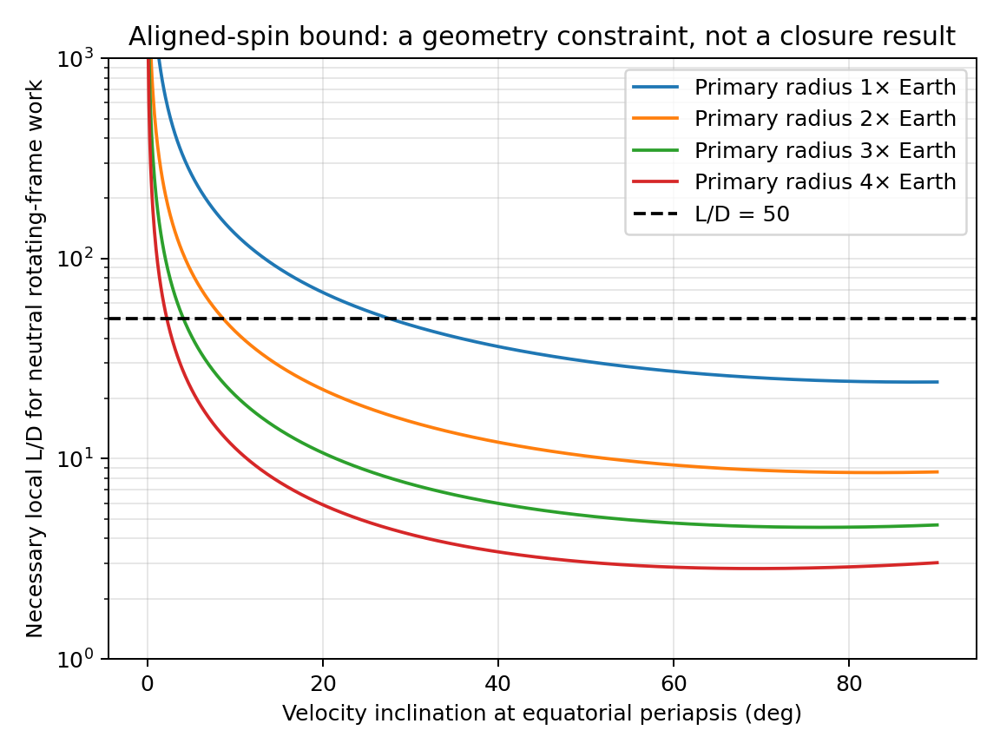
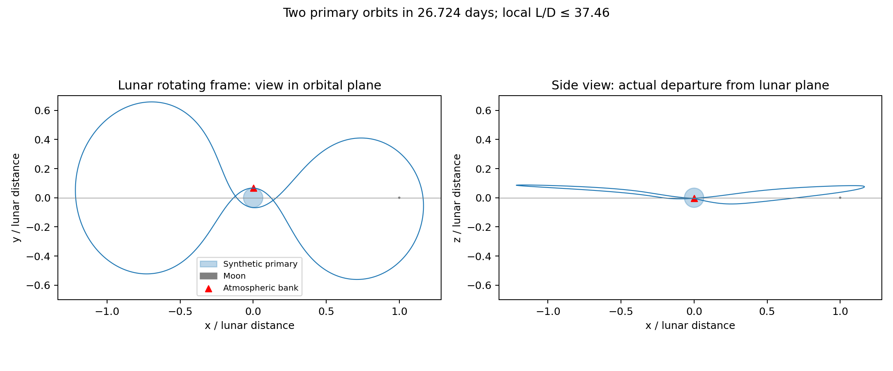
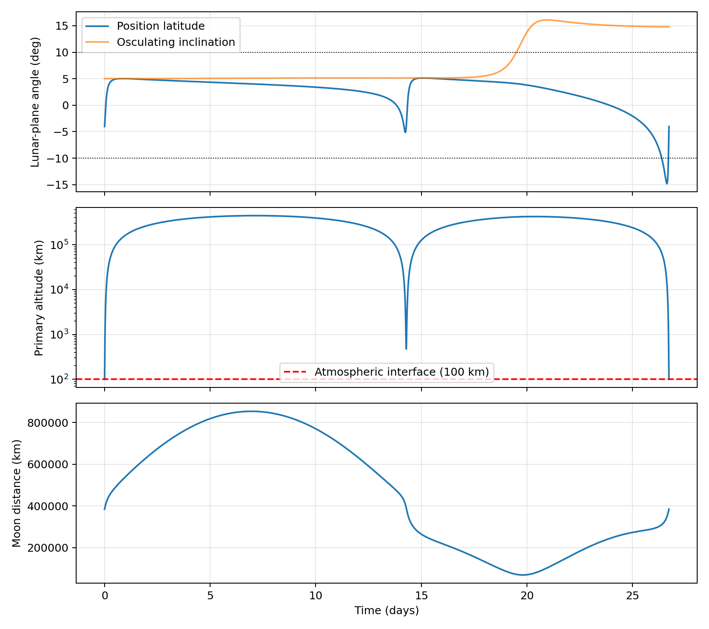
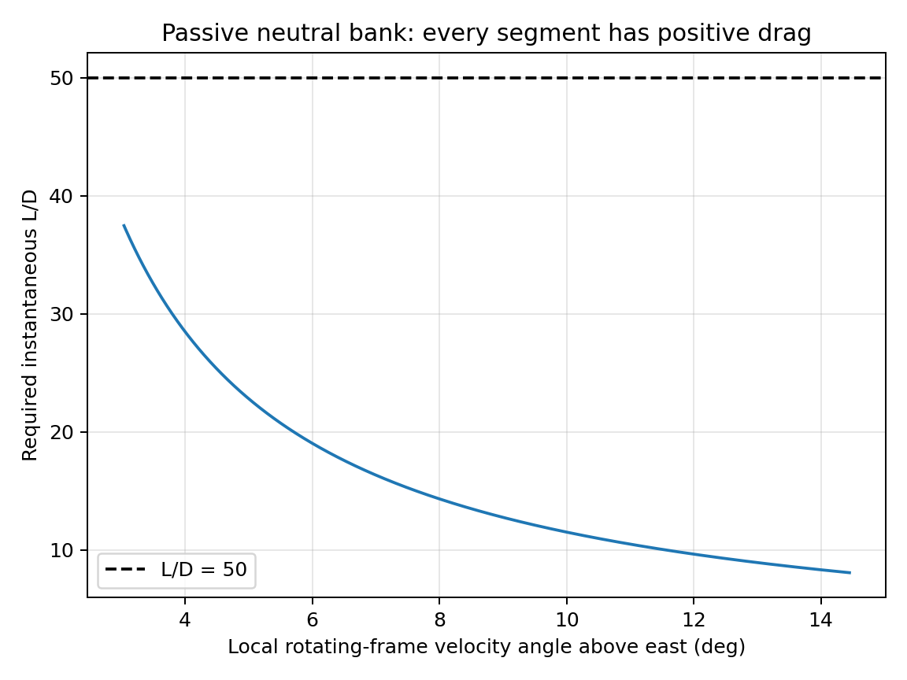

# Cislunar aerocycler: orbital-mechanics review and a monthly synthetic return

> **Scope correction, 2026-10-17:** the 26.724-day return below has a mostly eastward atmospheric encounter and is a different concept from the intended polar aerocycler. The [new polar investigation](aerocycler_polar_results.md) now verifies explicitly near-polar closures, including an Earth-radius example with L/D 25.685 and a toy-planet resonance/radius comparison. This earlier result is retained as a separate experiment, not as evidence for polar operation.

2026-10-14. Uses the repository's `.env` Python virtual environment.

## Result and scope

There is a useful result below L/D = 50 in the **idealized impulsive model**:
an Earth-mass primary with **four times Earth's solid radius**, a 100 km
atmospheric interface, and the original Earth rotation rate supports a
closed lunar-relative return every **26.724 days**. The required **maximum
local L/D is 37.464**, with positive drag throughout the modeled bank.
The vehicle completes two primary orbits between atmospheric maneuvers.
Its position stays within 5° of the Earth–Moon plane for **90.8% of the time**
and within 10° for **98.8%**. The primary and Moon are cleared.

This is a reproducible orbital and aerodynamic-work proof of concept in the
**intended reduced model**. The atmospheric maneuver is deliberately an
instantaneous impulse, with a resolved continuous path in **velocity space**.
A finite atmospheric simulation is a separate extension, tracked in
[GitHub issue #29](https://github.com/AlanCoding/orbital-shape-sim/issues/29).
No Earth-sized solution requiring L/D ≤ 50 was established in this investigation.

The [first investigation](aerocycler_investigation.md) contains the earlier
results, now marked with corrections. Its L/D ≈ 1,660 conclusion was not a
fundamental limit on the concept.

## What was wrong with the original interpretation?

### The search started polar, and the plotted angle used the wrong reference

`kepler_seed()` sets `v_lon = 0` and `v_lat = speed`. This makes a polar
ellipse. Both retained 4/2 solutions remain almost polar, with encounter
inclinations around 90° relative to the Moon's orbital plane.

The legacy `encounter_plane_excursions()` compares angular-momentum directions
in **lunar rotating axes at different times**. Its “7° departure” includes
rotation of the coordinates and is not drift from a fixed initial inertial
plane. It also does not mean the flight lies within 7° of the Earth–Moon plane.
For the zero-cross-track baseline, transforming each normal into inertial
coordinates gives encounter-plane angles approximately **0.984°, 1.562°,
2.545°, and 3.124°** from the initial inertial plane, instead of the legacy
alternating 7.164° and zero. The plane is still almost polar: its inclination
at those passes is about 89.992°.

Sampling the retained nonzero-cross-track trajectory gives
osculating inclinations approximately **89.95°–101.93°** and a maximum
absolute position latitude about **77.55°**.

The new diagnostics report both osculating inclination relative to the
lunar plane and actual position latitude, separately. Time percentages use
uniform time sampling rather than adaptive ODE steps, which cluster heavily
at periapsis.

### A finite impulse needs a finite-work calculation

At fixed position, let `dv` be an impulse and `u_in` the incoming velocity
relative to the atmosphere. Its exact atmosphere-relative work is

```text
W_atm = dv · (u_in + dv/2)
      = (|u_out|² - |u_in|²)/2.
```

The old diagnostic used `dv · u_in`, omitting `|dv|²/2`. A finite turn can
project against the incoming velocity even when it dissipates no energy;
this projection is not evidence of passive aerodynamic drag.

For the retained `J_E = 0.002` checkpoint, exact relative work is **positive
at every encounter**. Its closure impulse would increase atmospheric-frame
kinetic energy. Thus L/D ≈ 1,660 is withdrawn as a passive aerodynamic
requirement. The zero-cross-track baseline's relative work is essentially
zero at numerical precision, rather than demonstrating useful dissipation.
Both also have the previously reported surface-clearance problem.

The equations of coast motion and the original orbit closures passed their
regression checks. The important faults were in search geometry and physical
interpretation. The regenerated original JSON is schema v2, includes the
finite-work ledger, and labels its midpoint L/D projection as a necessary
work diagnostic rather than a flight feasibility test. The independent
[previous-branch audit](../results/aerocycler/previous_branch_audit.json)
records these findings.

The diagnostic now supports `reference_frame="inertial"` and records the
frame-corrected values alongside the legacy values. The old near-polar
initialization was a seed choice, not a hard 7° drift constraint. The fixed
cross-track impulse and closure constraints selected the examined branch;
they did not establish an unavoidable minimum plane drift.

## The orbital-mechanics floor

### The Moon constrains energy and angular momentum together

In the circular restricted three-body problem, ballistic motion conserves
the Jacobi integral `C`. Equivalently, the barycentric inertial combination
`E - n h_z` is conserved, where `n` is the Moon's orbital angular rate. This
is the standard rotating-frame invariant; see
[MIT's restricted-three-body lecture](https://ocw.mit.edu/courses/16-346-astrodynamics-fall-2008/resources/lec_25/).
The feasibility argument below is a derivation for this investigation,
not a claim that a published aerocycler design exists.

Write `v` for velocity in the lunar rotating frame and `f` for aerodynamic
acceleration. In normalized units,

```text
dC/dt = -2 v · f.
```

A periodic trajectory needs zero net change of `C` over its atmospheric
segments. Lunar gravity cannot compensate arbitrary drag loss: it preserves
the same invariant during every coast. This is why a candidate must pass a
work test in addition to closing its six-state trajectory.

### Rotation creates the crossflow needed for lift to offset drag

For aligned spin, the atmosphere moves through the lunar rotating frame at

```text
a = (sigma - 1) zhat × q,     sigma = Omega_E / n,
u = v - a.
```

If `f = D(-u_hat + K l_hat)`, with `K = L/D`, `D > 0`, and lift direction
`l_hat` perpendicular to `u`, the greatest possible rotating-frame work is

```text
max(v · f)/D = -v · u_hat + K |v perpendicular to u|.
```

Therefore, wherever `v · u > 0`, the necessary local threshold for
nonnegative rotating-frame work is

```text
K_floor = (v · u) / |v × u|.
```

If every drag-producing atmospheric segment has a floor above the vehicle's
available L/D, periodic closure is impossible in this circular model. Meeting
the floor does **not** guarantee a lunar return, surface clearance, or an
admissible finite atmospheric trajectory. A cycle can contain both positive
and negative changes of `C`; it is their sum that must vanish. The new
single-bank construction deliberately makes its one bank Jacobi-neutral.

At an equatorial periapsis, let `V` be rotating-frame speed and `theta` its
angle above east. With `A = (sigma - 1) r`, the threshold simplifies to

```text
K_floor = (V - A cos(theta)) / (A |sin(theta)|).
```

For a lunar-reaching Earth orbit, periapsis speed is about 11.1 km/s. Earth's
equatorial atmosphere moves at about 0.465 km/s, while the lunar rotating
frame moves at only `n R_E ≈ 0.017 km/s` **at Earth**. The useful differential
surface speed is consequently about **0.448 km/s**, giving the favorable
scale `11.1 / 0.448 ≈ 24.7`. It is not the ratio of Earth's surface speed
to the Moon's approximately 1.02 km/s translational speed: the lever arms
enter through angular momentum. The physical constants are consistent with
[NASA's Earth fact sheet](https://nssdc.gsfc.nasa.gov/planetary/factsheet/earthfact.html)
and [Moon fact sheet](https://nssdc.gsfc.nasa.gov/planetary/factsheet/moonfact.html).

Thus the anticipated **20-something number has a sound basis**, but its
favorable crossflow geometry is close to polar in the aligned-spin model.
Near the lunar plane, most atmospheric motion is along the flight direction,
so lift has much less scope to restore rotating-frame energy.

For the nominal 2/1 Kepler seed at a **100 km interface**, the exact vector
formula gives the following necessary thresholds:

| Periapsis velocity inclination | Earth radius | Four Earth radii |
|---|---:|---:|
| 5° | 265.1 | 22.4 |
| 10° | 133.1 | 11.3 |
| 20° | 67.7 | 5.9 |
| 30° | 46.5 | 4.2 |
| 90° | 24.2 | 3.0 |



Changing the radius helps twice: at fixed primary mass, encounter speed
roughly falls as `R^-1/2`, while atmospheric rotation speed grows as `R`.
The leading speed-ratio scale therefore falls roughly as **`R^-3/2`**.
This makes a synthetic radius change a meaningful experiment grounded in
orbital mechanics.

### Earth's tilted spin is a further lead, with an extra closure requirement

Earth's spin is not aligned with the Moon's orbital normal. The lunar orbit
inclination to Earth's equator ranges from **18.28° to 28.58°**, according to
the [NASA Moon fact sheet](https://nssdc.gsfc.nasa.gov/planetary/factsheet/moonfact.html).
This can provide crossflow even when the vehicle follows the lunar plane.
The aligned-spin table is therefore not a universal impossibility bound for
real Earth.

The general calculation uses

```text
a(t) = [sigma s_rot(t) - zhat] × q,
```

where the spin axis is fixed **in inertial space**. A tilted axis must rotate
in synodic coordinates. Freezing a tilted axis in the lunar frame would
create an artificial energy source geometry. Furthermore, a return period
that is not an integer lunar sidereal period does not repeat a tilted
atmosphere's orientation. The code checks this distinction explicitly.

## The new construction

The retained candidate starts at an atmospheric periapsis with no radial
impulse, coasts through **two** Earth-relative periapses, and banks only at
the final return. The intervening periapsis is higher than the interface.
Three shooting variables—longitude, latitude, and initial tangential speed—
enforce the final position returning to the initial position, at fixed
initial local velocity angle.

Ballistic Jacobi conservation then gives the incoming rotating-frame speed
needed at that position. The bank turns the tangent velocity back to its
initial direction while preserving rotating-frame speed exactly. Both
endpoints are periapses, and the reconstructed outgoing state is checked
against the complete initial six-state vector.

Unlike the original constant-identical-impulse formulation, this model
allows a high intermediate periapsis without forcing an aerodynamic maneuver
there. This is an explicit change in the control assumptions, appropriate
to the monthly-return objective.

The bank's velocity-space path is sampled at 2,001 points. At **each** point,
drag opposes the current atmospheric relative velocity and lift is
perpendicular to it. Every point must have positive drag. The result reports
the **largest local L/D**, not the substantially smaller ratio obtained by
integrating lift and drag over the whole turn.

## Retained result: four-radius synthetic primary

Only the solid radius is changed from the Earth–Moon gravity model. Mass
ratio, Moon radius, separation, and primary rotation rate retain their
original values. A separate 100 km interface prevents a surface grazing
idealization from being presented as clearance.

| Quantity | Validated value |
|---|---:|
| Solid primary radius | 25,512.5452 km = 4 Earth radii |
| Atmospheric interface radius | 25,612.5452 km |
| Primary orbits / atmospheric banks per return | 2 / 1 |
| Return period | 26.7240057263 days |
| Return period / lunar sidereal month | 0.978125222 |
| Maximum required local L/D | **37.46378322** |
| Minimum local L/D along bank | 8.0784 |
| Integrated lift / integrated drag | 13.1927; **not** the vehicle requirement |
| Minimum primary altitude | 100.000 km |
| Intervening periapsis altitude | about 472 km |
| Closest lunar altitude | about 67,430 km |
| Osculating inclination to lunar plane | 5.02°–16.09° |
| Maximum absolute position latitude | 14.82° |
| Time RMS position latitude | 4.10° |
| Time within 5° / 10° of lunar plane | 90.80% / 98.81% |
| Maximum position latitude beyond half the lunar distance | 5.11° |
| Position closure, normal verification | `1.06e-12` normalized length, about 0.41 mm |
| Velocity closure, normal verification | `7.31e-11` normalized speed |
| Largest coast Jacobi drift | `9.48e-12` |
| Bank Jacobi jump | zero at reported precision |



The **2/1 is a seed-family label**, not an exact two-orbits-per-sidereal-month
claim. The corrected period differs from one lunar month by 2.19%, and the
inertial apsidal direction precesses about **7.875° per return**. The full
state closes in the lunar rotating frame. With aligned spin, the atmosphere
also repeats in that frame, so the recurring lunar-relative return is valid
in this model. The monthly cadence uses small orbit counts and does not rely
on a large-integer resonance.

The high lunar altitude should also be stated plainly. This is a broad lunar
encounter, not a low-altitude Moon flyby or a demonstrated rendezvous orbit.
Likewise, it stays **mostly** near the lunar plane but does not meet a strict
10° osculating-inclination cap at every instant.

The synthetic primary also remains below its equatorial centrifugal-breakup
rotation rate. This check matters when experimenting with still larger radii
at fixed mass and spin.



During the bank the local rotating velocity angle above east decreases from
14.45° to 3.038°. The local 3° input is not itself the orbital inclination:
the periapsis latitude is about −4.03°, so outgoing inclination is about 5°.
The resulting velocity change has magnitude about **1.07 km/s**. It has no
radial kick. The fairly large maneuver is another reason to require a finite
atmospheric-flight calculation before treating this as a practical design.

The work ledger is particularly useful:

```text
rotating-frame work              ≈ 0
primary-relative Delta-h_z       = +0.0105184873
atmosphere-relative work         = -0.2776508512
```

In normalized units, `Delta-E_primary = Delta-h_z` for this Jacobi-neutral
impulse, and `W_atm = (1-sigma) Delta-h_z`. Thus the bank increases prograde
angular momentum, transfers primary rotational energy to the vehicle, and
dissipates energy relative to the atmosphere. Lunar gravitational dynamics
reverse the relevant change during the coast. This is the mechanical cycle
that the original investigation did not explain.



Fixed-input propagation at `rtol=2e-13`, `atol=2e-15`, `max_step=0.006` was
repeated at `rtol=3e-14`, `atol=3e-16`, `max_step=0.004`. The latter gives
position closure `3.60e-14`, velocity closure `1.45e-12`, and maximum local
L/D differing by less than `1e-8`. This checks numerical integration, not
physical atmospheric feasibility or orbital stability.

The complete inputs, states, trajectory history, work ledger, local bank
requirements, and tolerance comparison are in
[synthetic_monthly_bank.json](../results/aerocycler/synthetic_monthly_bank.json).

## Earth-sized checkpoint and rejected leads

The same construction also closes with an Earth-sized solid primary and a
100 km interface: **27.0494 days**, with maximum local **L/D = 442.69**.
Its position stays within 5° of the lunar plane for 95.93% of the flight time,
and all periapses clear the surface. This validates the construction at
Earth scale, but does not meet the desired aerodynamic target. It is one
branch, not an optimized lower bound. Inputs and independent verification
are in [earth_monthly_bank.json](../results/aerocycler/earth_monthly_bank.json).

Several leads were examined before selecting the retained result:

- One- and two-month seed families with 1–4 primary orbits, including 2/1,
  3/1, 3/2, and 4/2; no large-integer resonance search was used.
- Local velocity-angle continuation and radius continuation on the passive
  2/1 branch. Raising the radius reduces L/D consistently with the derived
  scaling. At approximately 3.5 radii, the 3°-angle branch is still just
  above L/D = 50; the four-radius checkpoint supplies useful margin.
- Exact one-sidereal-month 3/1 returns, allowing the initial angle to vary,
  with an inertially fixed tilted spin axis. For example, a 2.5-radius root
  has maximum local L/D about 18.7 at a 23.44° spin tilt and position latitude
  below 10°. **Rejected:** its first periapsis lies about 1,043 km below its
  specified surface. Smaller-radius continuation also loses closure.
- Three independent Jacobi-neutral banks with equal interface radii and an
  exact monthly period. The attempted correctors did not satisfy all the
  conditions. This is a failed numerical attempt, not a nonexistence proof.

The exploratory search and continuation files remain in
[`results/aerocycler`](../results/aerocycler). Only the two specifically named
retained bank-return JSON files have the full independent audit described
here. Positive impulse projections or low reported ratios in exploratory
files do not establish a viable vehicle or a closed, collision-free return.

## Reproduce and extend

From the repository root, use the existing virtual environment:

```bash
PYTHONPATH=src .env/bin/pytest -q tests/test_aerocycler.py tests/test_aerocycler_banking.py
PYTHONPATH=src MPLCONFIGDIR=/tmp/mplconfig .env/bin/python scripts/aerocycler_revisit.py
```

The second command performs fixed-input verification and regenerates all
four review figures. It does **not** invoke an optimizer. To search new
nearby returns with the full passivity and clearance audit:

```bash
PYTHONPATH=src .env/bin/python scripts/aerocycler_bank_search.py \
  --loops 2 --months 1 --radius-factor 4 --inclination 3 --starts 16 \
  --interface-altitude-km 100 --initial-latitude -4
```

Here `--inclination` means the initial **local inertial velocity angle above
east**. Inspect the separate actual inclination diagnostics. The radius
factor specifies the **solid primary**, while the interface altitude is
separate. ODE success is distinguished from accepted idealized closure.

The main implementation is in `src/aerocycler/aerodynamics.py` and
`src/aerocycler/banking.py`. The original solver is preserved; its equations
were rewritten componentwise for faster optimization, with an independent
vector-equation regression check. It now also accepts an optional periapsis
control callback for experimental bank schedules.

All **40 active tests** in `tests/` pass, including eight aerocycler
physics/regression tests. A repository-wide
collection attempt additionally encounters the archived `moon_tidal_tether`
tests, whose `tskb` package is missing from this environment; those collection
errors are unrelated to this work.

The most useful next investigation is a **finite atmospheric arc** on the
synthetic branch, beginning with its recorded incoming/outgoing states and
an effective L/D envelope of 40–50. That would determine whether altitude,
gravity, loads, and duration can realize the idealized turn without losing
monthly closure. Separately, Earth's actual spin tilt remains a credible
route to lower Earth-sized L/D, but requires atmosphere-phase closure as well
as orbital closure. These are unresolved research steps, not results claimed
by the present proof of concept.

## Reading the retained orbit: passes, angles, and impulse directions

This section describes the existing checkpoint; no additional orbit search
is required to obtain these quantities.

### Two Earth passes, one atmospheric impulse

The cycle starts just after a bank at a 100 km periapsis. Its next close
Earth pass is at **day 14.2851567**, about **471.998 km** above the synthetic
surface, with **no impulse**. A broad lunar approach follows near **day
19.80694**. At **day 26.7240057**, the vehicle returns to the **100 km**
periapsis and receives the bank that starts the next cycle.

Thus there are **two Earth passes per period, but only one atmospheric
impulse**. Counting the opening day-zero periapsis as a third pass would
double-count the cycle boundary.

### Three different meanings of an angle

The **position latitude** is the angle of the Earth-center-to-vehicle line
above the Earth–Moon plane: `beta = asin(z/r)`. Its signed range is **−14.816°
to +5.128°**. The orbit does not reach 10° *above* the plane; the brief larger
excursion is below it, near the end of the return. Near closest lunar
approach, latitude is **+3.919°**, with `r ≈ 446,997 km` and `z ≈ 30,550 km`.
The most negative latitude occurs around day 26.628, at `r ≈ 39,029 km` and
`z ≈ −9,980 km`. A modest angular latitude far away can therefore correspond
to a greater height than a larger angular latitude near Earth.

The **osculating inclination** describes the plane spanned by the instantaneous
position and primary-relative inertial velocity. It ranges from **5.02° to
16.09°**. The Moon applies torque, so this instantaneous plane changes during
the flight; the trajectory is not one immutable Kepler ellipse.

The search's **3° input** is the initial inertial velocity angle above **local
east**, at a periapsis latitude near −4.03°. It is neither position latitude
nor deviation from polar. Those two initial angles together give the roughly
5° initial osculating inclination.

The trajectory is spatial because its initial `z` and vertical velocity are
nonzero. A circular restricted three-body model preserves exactly planar
motion only when both start at zero and the impulses preserve that plane.
No such planar restriction was imposed on this root.

### The impulse is tangent to the surface

The net impulse is expressed below in local directions at the atmospheric
periapsis. “Radial” means directly toward or away from the primary's center;
local north is perpendicular to radial, not straight up from the lunar plane.

| Component | Net velocity change |
|---|---:|
| Eastward | **+161.920 m/s** |
| Northward | **−1,052.764 m/s**, i.e. southward |
| Radially away from the primary center | **0 m/s**, within numerical error |
| Total magnitude | **1,065.143 m/s** |

The incoming eastward/northward velocities are about **5,255 / 1,337 m/s**;
the outgoing values are about **5,417 / 284 m/s**. The vehicle still moves
northward immediately after the impulse: the southward change removes most
of its northward component while increasing its eastward component.

It mainly turns the velocity. Primary-relative inertial speed changes only
from **5,422.68 to 5,424.71 m/s**, despite the 1.07 km/s vector change.
Atmosphere-relative speed decreases from **3,646.12 to 3,565.51 m/s**. Thus
the eastward net component is consistent with passive lift and drag while
extracting rotational energy. It is not a radial push out of Earth's gravity.

### What a longer period would change

A longer return is a reasonable branch-search hypothesis, especially if it
provides more favorable lunar encounter geometry or additional opportunities
to change the direction of angular momentum. It does not automatically lower
the local rotational L/D bound. At fixed periapsis radius, Kepler's relation
`v_p² = GM (2/r_p - 1/a)` makes periapsis speed increase slightly with orbital
period, approaching escape speed. In this model, at an Earth-sized 100 km
periapsis, increasing an individual Kepler orbit from 13.362 to 27.322 days
raises encounter speed from about **11.002 to 11.031 km/s**. Any substantial
improvement would therefore come from better geometry or control scheduling,
rather than the longer period alone. That search is left for follow-up.
