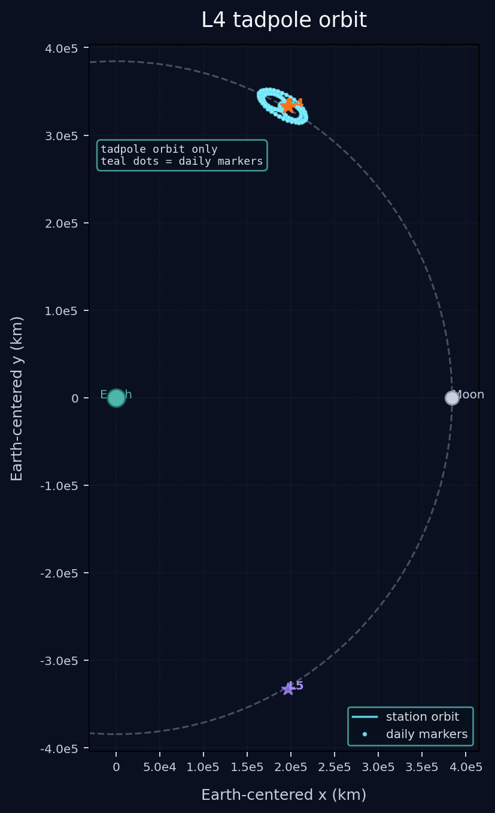
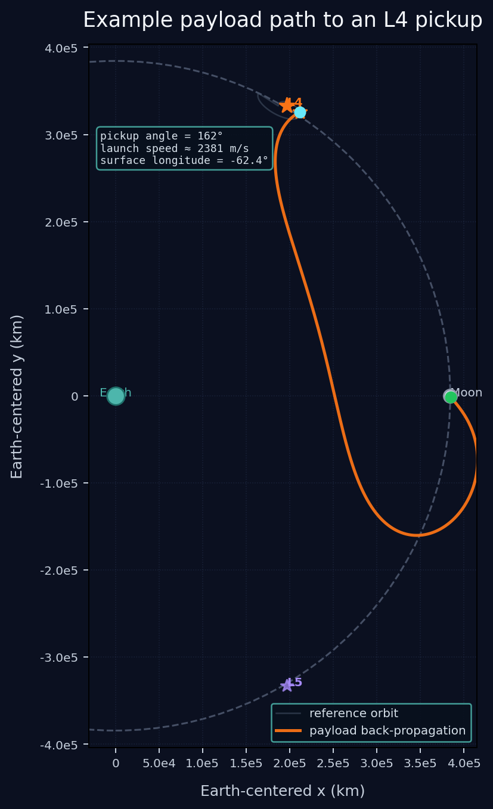
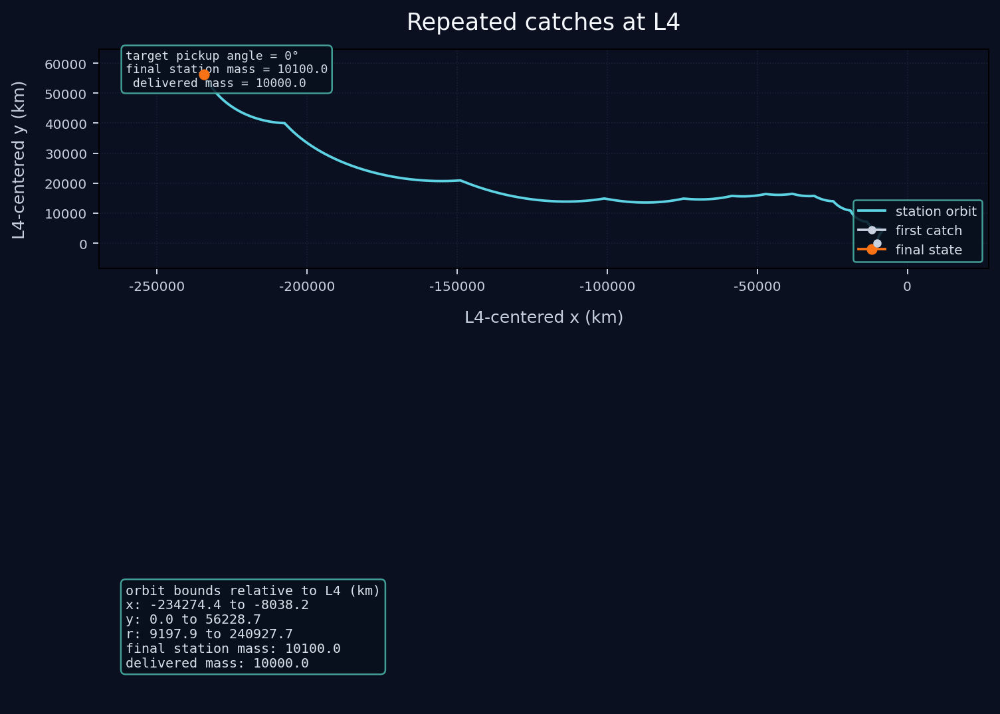
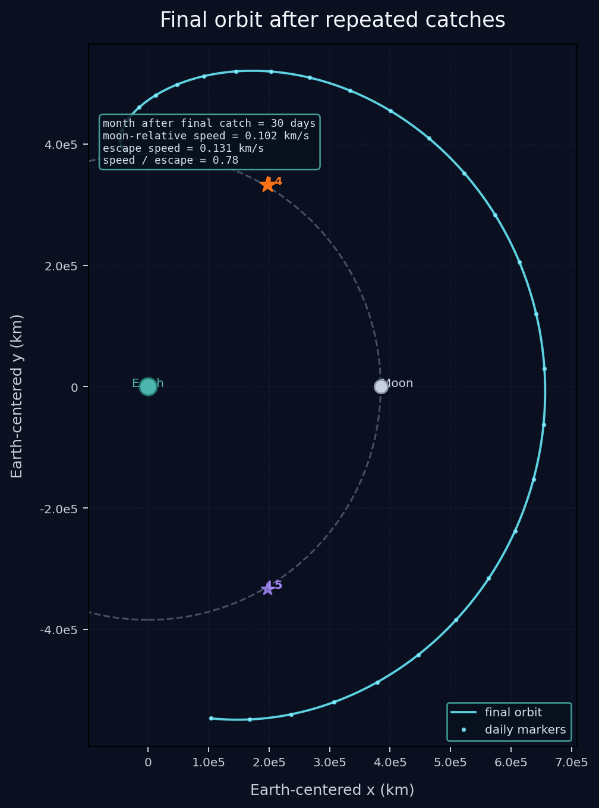

# Chapter 6: L4 Mass Receipt

Run the chapter with:

```bash
PYTHONPATH=src MPLCONFIGDIR=/tmp .env/bin/python -m l4_receipt
```

The figures are written to `docs/assets/l4_receipt/`.

This chapter follows the L1 stabilizer material and shifts to the Earth-Moon
`L4` point. The station is finite mass, the simulation remains Cartesian in the
co-rotating Earth-Moon frame, and the visuals stay fixed to that rotating
frame so Earth and Moon remain stationary in the plots.

The goal is deliberately modest: show a small tadpole orbit around `L4`, show
one example payload trajectory that back-propagates to the lunar surface, and
then show what happens when the station receives mass on every loop.

The `L5` case is deferred. The triangular points are asymmetric, so the first
chapter should stand on its own before the other side is repeated.

## Model

The station is treated as a finite-mass receiver that moves in the rotating
Earth-Moon frame under the same basic gravitational model used elsewhere in the
repository. The payload catch is instantaneous:

- the payload and station velocities are combined by conservation of momentum
- the station mass increases immediately
- the orbit is then continued from the new post-catch velocity

The payload arrivals are chosen by root-finding on the station's velocity
direction. In practice, the chapter samples the orbit at about `20` angular bins
over a `60` day reference window, uses the Moon-facing pickup to build the
example delivery path, and then reuses a coarse pickup schedule for the
repeated-catch pass.

## 1. Tadpole Orbit

The first figure shows the station's tadpole orbit around `L4` with the Earth
and Moon fixed in the co-rotating frame. The underlying integration runs for
`150` days so the figure can show how the motion evolves over multiple cycles.
The teal dots mark one-day steps along the station trajectory.
The seed begins about `10,000 km` away from `L4` on the Moon-leading side
with a tangential `y`-velocity of roughly `25 m/s`, chosen from the local
linearized L4 mode so the motion reads as a tadpole-like loop rather than a
direct pass through the point.



## 2. Example Payload Catch

The second figure takes the Moon-side pickup point from the reference orbit and
back-propagates a payload trajectory from that catch state toward the lunar
surface. The payload launch is
assumed to be tangential to the local lunar frame at roughly `260 m/s`, and the
reverse trajectory gives the surface site and longitude that correspond to that
delivery geometry.



## 3. Repeated Catch Chain

The third figure replays the planned pickup schedule derived from the coarse
scan. The delivered mass grows geometrically, starting at `1` unit and
increasing by a factor of about `1.6` until the total delivered mass
approaches `10,000` units.

The plotted orbit is now shown in an `L4`-centered frame with tight bounds so
the post-catch shape is readable, and the summary panel reports the actual
orbit extents in kilometers.

This is the stress test for stability: if the orbit remains tadpole-like after
the momentum kicks, the receiver is still operating near `L4`. If the path
collapses into a more Moon-centered loop, the lock has failed.



## 4. Post-Catch Orbit

The last figure takes the final post-catch state and runs it forward for one
month with the Earth and Moon shown again. This is the cleanest way to answer
the escape question: the post-catch speed is still below the local Moon escape
speed in a simple two-body sense, so the station is not immediately on an
escape trajectory.



## Interpretation

This chapter is intentionally the first pass for `L4` only.

The point is not to prove a fully optimized receiver. It is to answer the
lower-level question first:

- can a finite-mass station remain near `L4` while it absorbs discrete payloads?
- does the orbit stay tadpole-like after each catch?
- what surface site and arrival geometry does the payload back-propagation imply?

Once this side is clear, the same method can be repeated for `L5`.
